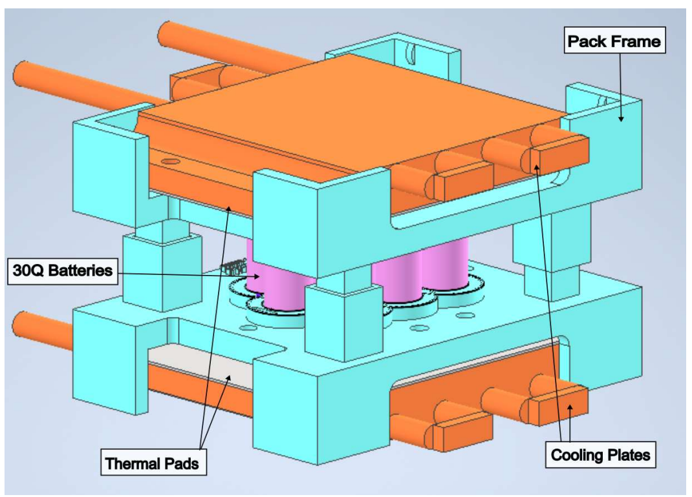

# Smart-Pack-for-Advanced-Research-and-Control (SPARC)
SPARC is an open-source, research-grade battery system (module/pack) designed to advance thermal and electro-thermal modeling techniques while integrating state-of-the-art sensing and Battery Management System (BMS) technologies. Its modular design supports both cylindrical and pouch cell configurations, enabling cutting-edge investigations into battery performance, health, and reliability under diverse operating conditions.

   
The SPARC system, showing the battery module.  

## Variations

### Camden
A pack designed around the Samsung 30Q as a 10S1P nominal 40 V pack. 

## Licensing and Citation

This work is licensed under a Creative Commons Attribution-ShareAlike 4.0 International License [cc-by-sa 4.0].

Cite this as: 

@Misc{ARTSLabSmartPackAdvanced,    
  author = {ARTS-Lab},  
  howpublished = {GitHub},  
  title  = {Smart-Pack-for-Advanced-Research-and-Control},    
  groups = {ARTS-Lab},    
  url    = {https://github.com/ARTS-Laboratory/Smart-Pack-for-Advanced-Research-and-Control},   
  note  = {Accessed: Month dd, yyyy},   
}

QR code for repo.

